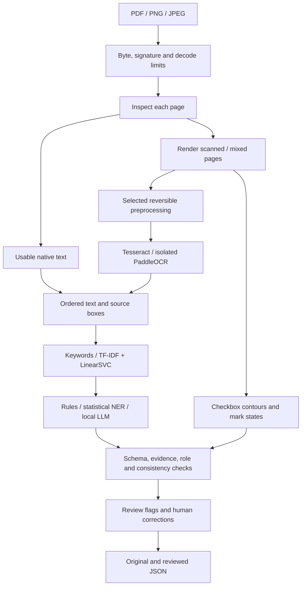

# Architecture and contracts

## Data flow

## Modules

| Module | Input | Output | Failure handling |
|---|---|---|---|
| Ingestion | A local bounded upload | Decoded document, words, page metadata | Signature mismatch, corrupt/encrypted input, excessive pages/pixels |
| Routing | Page text, printable characters, image coverage | `digital`, `ocr`, or `hybrid` | Conservative heuristic; force-OCR override; unsupported/failed pages stay visible |
| Preprocessing | RGB page | Profile image and inverse transform | Blank-page checks; original retained; no automatic cropping |
| OCR | Rendered page and deadline | Word/line spans with raw scores and original-page boxes | Missing engine, timeout, native-worker failure |
| OMR | Original image plus text boxes | Labeled checked/unchecked/ambiguous boxes | Compact/sparse marks remain ambiguous; unlabeled boxes trigger review |
| Classification | Ordered text | Category, method, raw margin | Validation-selected rejection threshold; zero known vocabulary becomes unknown |
| Extraction | Text and evidence | Scalar fields and medication groups | Missing, conflicting, or unsupported values stay null or flagged |
| Validation | Candidate result | Issues, required missing fields, review reasons | Structural and extraction consistency only; no treatment assessment |
| API/UI | Upload and chosen settings | Reviewable result and exports | Bounded request bodies, busy state, safe temporary paths, clear errors |

PDF image regions cause the page to take the hybrid route. The current baseline OCRs the full rendered hybrid page and suppresses overlapping native-word duplicates. This favors completeness over speed; region-only OCR is a later optimization. Multi-column and overlapping text layers still require review.

## Public Python contract

`process_document(path: Path, settings: Settings | None) -> DocumentResult`

Pydantic forbids unknown result properties. `DocumentResult` contains schema version, content-derived document ID, category, pages, fields, medications, missing fields, validation issues, review reasons, status, durations, and engine/configuration metadata. `MedicationResult` separates name, strength, administered dose, instructions, and frequency.

`FieldResult` contains nullable value, extraction method, supporting evidence, status, and optional raw engine diagnostics. Rejected candidates are retained as `rejected_value` for evaluation while `value` becomes null. This preserves visibility into attempted unsupported extraction.

Evidence uses one-based page numbers and `[x0, y0, x1, y1]` coordinates normalized to the original page. Geometry transforms are inverted before export. Reading order is established in the corrected image before boxes are restored. Paddle line spans are not presented as precise word segmentation.

## HTTP contracts

- `GET /health`: local configuration and passive engine/artifact availability; no model inference.
- `POST /process`: multipart `file`; query parameters `ocr_engine`, `extraction_method`, `preprocessing`, `force_ocr`; returns `DocumentResult`.
- `POST /review`: original `DocumentResult` and a map of field-path corrections `{value, reason}`. Returns original predictions, separate corrections, and revalidated review state.
- `GET /benchmarks`: saved local aggregate measurements, or `not_run`.

Typical statuses: 413 for size/page/pixel limits, 415 unsupported extension, 422 invalid/decode input, 429 busy, and 503 unavailable selected engines. Per-page OCR failures can produce an explicit partial/failed document result with review reasons.

The API admits one inference job per process. Run one Uvicorn worker. There is no queue, database, authentication, remote deployment, or durable job store. API body spooling enforces a limit before multipart parsing, including streamed bodies; the file payload is checked again while copying.

## Limits and uncertainty

Default limits: 20 MiB, 10 pages, 25 million rendered pixels/page, 200 DPI, 30 seconds per OCR/LLM call, and a shared 180-second document budget. Native rendering is pixel-bounded and checked between stages; it is not isolated in a hard-kill process sandbox. Do not expose this demo to untrusted public traffic.

Raw OCR scores, interior ink ratios, and classifier margins are not calibrated probabilities. Review flags come from named deterministic conditions. A substring match is only one check: field-label context and instruction consistency are also checked, but semantic evidence interpretation is not perfectly decidable by these rules.

Human corrections preserve the original result. Review validation may continue to flag page-level uncertainty even after individual fields are edited. That is deliberate: a field correction does not prove an unreadable page contained no other information.
